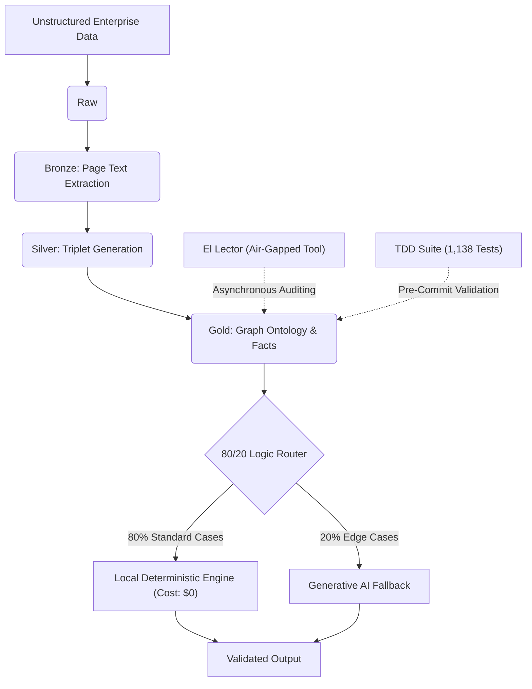
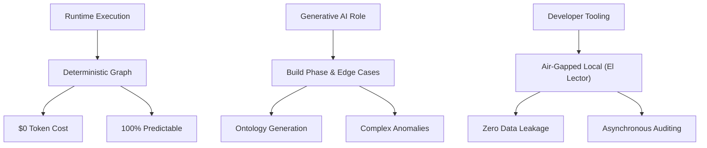

# Case Study 5: Deterministic Ontology Engine & Medallion Pipeline

---

## 📑 Table of Contents

1. Executive Summary
2. Key Performance Indicators
3. My Role & Ownership
4. The Challenge
5. Solution Architecture
6. Core Components & Entity Model
7. Engineering Decisions
8. Results & Metrics
9. Governance & Compliance Rules
10. Key Takeaways

---

## 🎯 Executive Summary & Architecture Positioning

### Paradigm Shift

Transitioned from **high-cost, non-deterministic generative AI agent workflows** to a **local, deterministic ontology engine** for runtime execution, reserving LLMs exclusively for edge-case fallback and initial ontology construction.

### Headline Result

**Architected an enterprise-grade Medallion pipeline and deterministic graph architecture** that:

* ✅ Eliminated repetitive LLM token costs per transaction (100% reduction)
* ✅ Automated 80% of core business logic through deterministic schema contracts
* ✅ Achieved zero-defect baseline via 1,138 automated TDD green tests
* ✅ Engineered an air-gapped, zero-telemetry local auditing tool (*El Lector*) to guarantee Fortune 100 data privacy

---

## 🚀 Key Performance Indicators

### Critical Success Metrics

| KPI | Before | After | Impact |
| --- | --- | --- | --- |
| **Runtime Token Cost** | High / Variable | $0 per transaction | 💰 100% Reduction |
| **Logic Automation** | Generative LLMs | Graph Contracts | ⚡ 80% Deterministic |
| **Test Infrastructure** | Manual / Ad-hoc | 1,138 Automated Tests | 🛡️ Enterprise Stability |
| **Evaluation Scale** | Small / Isolated | 347 Verified Cases | 📊 Massive Validation |
| **Data Privacy** | Cloud Telemetry Risk | Air-gapped (El Lector) | ✅ Zero Data Leakage |

### Detailed Performance Breakdown

**Cost & Execution Optimization**

| Metric | Legacy Workflow | Optimized Architecture | Result |
| --- | --- | --- | --- |
| Transaction Cost | Pay-per-API call | Local Compute ($0) | Infinite scale without marginal cost |
| Execution Engine | Multi-Agent LLMs | Deterministic Ontology | Zero Hallucinations |
| Edge Case Handling | Fails silently | Generative Fallback (20%) | High resilience |

---

## 👨‍💼 My Role & Ownership

* **Architected** the complete Medallion data pipeline (Raw → Bronze → Silver → Gold) to transform unstructured Fortune 100 enterprise data into deterministic graph ontologies.
* **Designed** and implemented the **80/20 Architecture Rule**, proving that generative models should be strictly reserved for complex edge cases rather than standard logic processing.
* **Engineered "El Lector"**, an air-gapped, zero-telemetry local developer tool allowing asynchronous task auditing, domain know-how tracking, and offline text-to-speech reading without exposing sensitive client data.
* **Enforced** strict Test-Driven AI Development (TDD) methodologies, mandating fault-injection, mutation testing, and achieving 1,138 automated green tests prior to integration.
* **Led** high-level R&D spikes, filtering ambiguous stakeholder needs into rigorous, executable engineering roadmaps and strict *Definitions of Ready*.

---

## 🔍 The Macro Engineering Challenge

### The Problem Domain

Processing highly unstructured, complex enterprise documentation for Fortune 100 clients requires absolute precision. The existing paradigm relied heavily on multi-stage agentic LLM workflows for daily transaction processing.

### Why Generative Agents Failed in Runtime

* **Unsustainable Token Burn:** Running multi-agent LLM loops for every transaction creates massive, compounding cloud costs.
* **Non-Deterministic Execution:** LLMs introduce variance; enterprise compliance requires exact, repeatable logic.
* **Data Privacy Risks:** Sending highly sensitive client data to external APIs or cloud telemetry tools violates strict InfoSec boundaries.
* **Lack of Governance:** No clear boundaries on what the AI decides versus what strict business rules dictate.

### The Architectural Mandate

**Build a deterministic system** that handles the bulk of operations locally and predictably, utilizing GenAI only where its reasoning capabilities are strictly necessary.

---

## 🏗️ Solution Architecture & Component Breakdown

### 📊 Data Layer: Medallion Architecture

**Key Mechanics:**

* **Raw:** Ingestion of pristine, unmodified documents.
* **Bronze:** Text extraction mapped physically by page and coordinates.
* **Silver:** Alignment and generation of semantic triplets.
* **Gold:** Formal facts and extraction mapped directly to the ontology.

---

### 🔧 Tooling & Governance Layer: El Lector & TDD

**Architecture:**

* **El Lector:** A local HTML/Python-based dashboard running strictly on `127.0.0.1`. It reads from local directories, parses Markdown/Mermaid, and features Text-to-Speech (TTS) for asynchronous review.
* **Zero-Telemetry:** Explicitly excludes client data folders from indexing.
* **TDD Enforcement:** 11 individual modules subjected to 32 boundary conditions, with "red-before-green" testing mandates.

---

## 📐 Core Components & Entity Model

### Verified Entity Relationships

| Component | Type | Role | Relationships |
| --- | --- | --- | --- |
| **Medallion Pipeline** | Data Flow | State management | Raw → Bronze → Silver → Gold |
| **Graph Ontology** | Logic | Business rules | Replaces LLM decision-making |
| **Generative Router** | Service | Edge-case handler | Activated only for <20% of cases |
| **El Lector** | Tooling | Developer auditing | Reads Tasks/Notes locally |
| **TDD Suite** | Quality | Defect prevention | Validates Silver/Gold outputs |

---

## ⚙️ Deep-Dive Engineering Decisions

### Decision 1️⃣ Deterministic Runtime vs. Agentic Runtime

| Element | Details |
| --- | --- |
| **Strategy** | Move runtime decision-making from GenAI to a local Graph Ontology. |
| **Rationale** | AI agents are too expensive and unpredictable for repetitive transaction processing. |
| **Outcome** | Eliminated per-transaction token costs. AI is now used to *build* the ontology, not to execute it daily. |

### Decision 2️⃣ The 80/20 Architecture Rule

| Element | Details |
| --- | --- |
| **Strategy** | Hardcode 80% of business logic into deterministic schema contracts. |
| **Critical Insight** | Most enterprise data follows a pattern; only true anomalies require AI reasoning. |
| **Outcome** | Massive latency and cost reduction; LLMs only trigger for edge cases. |

### Decision 3️⃣ Strict TDD in AI Engineering

| Element | Details |
| --- | --- |
| **Strategy** | Implement traditional software engineering rigor (Red/Green testing, mutation testing) into AI pipelines. |
| **Mechanism** | 1,138 automated tests across 347 verified cases. |
| **Outcome** | Eliminated structural hallucinations; absolute confidence in pipeline deployment. |

---

## 📊 Quantitative & Qualitative Metrics

### Hard Engineering Metrics

| Metric | Before | After | Change | Status |
| --- | --- | --- | --- | --- |
| **Runtime LLM Cost** | Per-Transaction | $0 (Local Compute) | 100% Reduction | ✅ Presented |
| **Test Coverage** | Unknown / Ad-Hoc | 1,138 Automated Tests | Enterprise-grade | ✅ Complete |
| **Validation Sample** | Small scale | 347 Verified Cases | Massive Scale | ✅ Verified |
| **Core Logic Execution** | Probabilistic | Deterministic (80%) | Predictable | ✅ Stable |

### Strategic Business Outcomes

✅ **Unprecedented ROI**

* Shifting execution to local compute eliminates the marginal cost of scaling AI operations.

✅ **InfoSec & Data Privacy Compliance**

* *El Lector* ensures developers can audit complex architectures and domain know-how without ever exposing sensitive client data to the internet or third-party tools.

✅ **Technical Governance**

* Ambiguous stakeholder requests are now forced through a strict *Definition of Ready*, transforming chaotic AI experiments into structured software engineering pipelines.

---

## ⚖️ Governance & Compliance Rules

### Operational Governance Framework

1. **The 80/20 Rule** — Generative AI must not be used for tasks that can be deterministically resolved by the graph ontology.
2. **Medallion Progression** — Data must strictly flow through Raw → Bronze → Silver → Gold states to ensure total auditability.
3. **Zero-Telemetry Tooling** — All internal developer tools (like *El Lector*) must run air-gapped on `127.0.0.1` and explicitly exclude client data repositories.
4. **Red-Before-Green Testing** — No AI module reaches production without passing fault-injection and boundary-condition testing (minimum baseline: 1,100+ tests).
5. **Generative Build vs. Runtime** — LLMs are approved for schema/ontology generation and naming (Build Phase), but heavily restricted during transaction processing (Runtime).

---

## 🎓 Key Takeaways

### What Worked

✅ **The 80/20 Ontology Split** — Drastically outperformed multi-agent LLM loops in cost, speed, and reliability.

✅ **TDD in AI** — Proved that AI engineering must adhere to the same rigorous testing standards as traditional software development.

✅ **Local Tooling (*El Lector*)** — Created immense developer velocity and focus without compromising strict Fortune 100 security boundaries.

### Lessons Learned

🔹 **Generative AI is a builder, not a runner.** It is best utilized to construct ontologies and handle edge cases, not to run daily deterministic transactions.

🔹 **Local compute is the ultimate optimization.** Shifting logic from cloud APIs to local graph engines is the most effective way to scale AI profit margins.

🔹 **Governance is architecture.** Imposing strict *Definitions of Ready* and TDD environments solves delivery bottlenecks faster than any prompt engineering technique.
